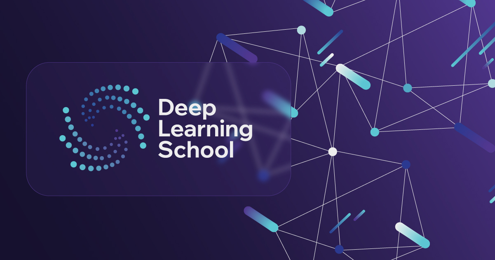

# Deep Learning School — Diffusion Week

  

Diffusion Week — серия онлайн-лекций о диффузионных моделях от DLS. В новом курсе мы разбираем с вами основы диффузионных моделей, а здесь идём дальше: спикеры из исследовательских команд и индустрии расскажут об актуальных направлениях исследований и о том, как диффузионные модели разрабатывают на практике. Среди спикеров — команды Kandinsky и AIRI. Все лекции проходят по вечерам в онлайн формате!

В этом репозитории мы соберём все основные материалы мероприятия.

- [**Чат мероприятия**](https://t.me/+j0AGX8QtLXE0YzM6)

- [**Наш сайт**](https://dls.samcs.ru/)

- [**Плейлист с записями лекций**](https://www.youtube.com/playlist?list=PLbDUOzR8qdp0)

- [**Наш телеграм канал**](https://t.me/deep_learning_school_news)

## Обратная связь

👉 Поделитесь впечатлениями о лекциях: https://forms.gle/f3h4NsxcsaTGJxTC8

## Перед началом: пререквизиты

Чтобы лекции Diffusion Week было проще понимать, рекомендуем заранее пройти материалы из папки [**prerequisites**](prerequisites/README.md): введение в диффузионные модели, score function, диффузию как SDE, Flow Matching и современные диффузионные модели.

## Материалы лекций Diffusion Week

| Lecture Title | Lecturer | Date | Video |  Tags  | Attachments |
|--------------|-----------|------|-------------|-------------------|-------------------|
| From Stable Diffusion to FLUX | Нина Коновалова | 28.10.2026 |   | `Diffusion` `Architectures` `Metrics` | [📊 Презентация](presentations/01_from_sd_to_flux/SD_to_FLUX_diffusion_week.pdf) ([pptx](presentations/01_from_sd_to_flux/SD_to_FLUX_diffusion_week.pptx)) |
| Image and Video Generation in 2026 | Константин Соболев | 29.10.2026 |   | `Diffusion` `Image Generation` `Video Generation` | [📊 Презентация](presentations/02_image_video_generation_2026/DLS_image_video_generation_2026.pdf) ([pptx](presentations/02_image_video_generation_2026/DLS_image_video_generation_2026.pptx)) |
| Diffusion for 3D and 3D in Diffusion | Нина Коновалова | 30.10.2026 |   | `Diffusion` `3D` `Generation` | [📊 Презентация](presentations/03_diffusion_for_3d/DLS_diffusion_3D_diffusion_week.pdf) ([pptx](presentations/03_diffusion_for_3d/DLS_diffusion_3D_diffusion_week.pptx)) |
| Как собрать миллиардный датасет для редактирования изображений | Владимир Архипкин | 02.11.2026 |   | `Datasets` `Image Editing` `Diffusion` | [📊 Презентация](presentations/04_dataset_image_editing/dataset.pdf) ([pptx](presentations/04_dataset_image_editing/dataset.pptx)) |
| Diffusion Reasoning: путь от рассуждений в LLM к диффузиям | Сергей Карпухин | 03.11.2026 |   | `Diffusion` `Reasoning` `LLM` | [📊 Презентация](presentations/05_diffusion_reasoning/diffusion_reasoning.pdf) |
| Alignment of Diffusion Models | Лев Новицкий | 03.11.2026 |   | `Diffusion` `Alignment` `RL` | [📊 Презентация](presentations/06_alignment/alignment_of_diffusion_models.pdf) |
| Персонализированная генерация в эпоху in-context моделей | Вера Соболева | 04.11.2026 |   | `Diffusion` `Personalization` `In-context` | [📊 Презентация](presentations/07_personalized_generation/personalized_generation.pdf) |
| Diffusion Distillation | Лев Новицкий | 05.11.2026 |   | `Diffusion` `Distillation` `Fast Sampling` | [📊 Презентация](presentations/08_distillation/diffusion_distillation.pdf) |
| Интерпретируемость диффузионных моделей | Нина Коновалова | 06.11.2026 |   | `Diffusion` `Interpretability` `SAE` | [📊 Презентация](presentations/09_interpretability/interpreting_diffusion_models.pdf) |
| Модели мира, Physical AI и Kandinsky | Андрей Иванюта | 06.11.2026 |   | `World Models` `Physical AI` `Video Generation` | [📊 Презентация](presentations/10_world_models/world_models.pdf) |

*Материалы следующих лекций появятся после их проведения.*
